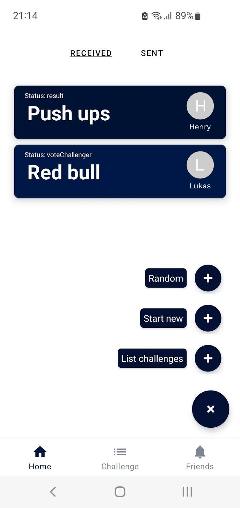
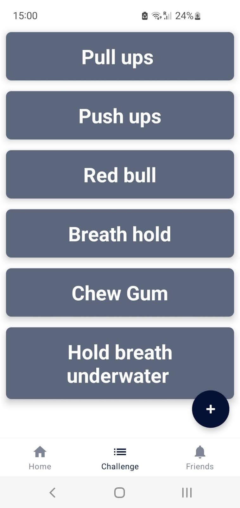
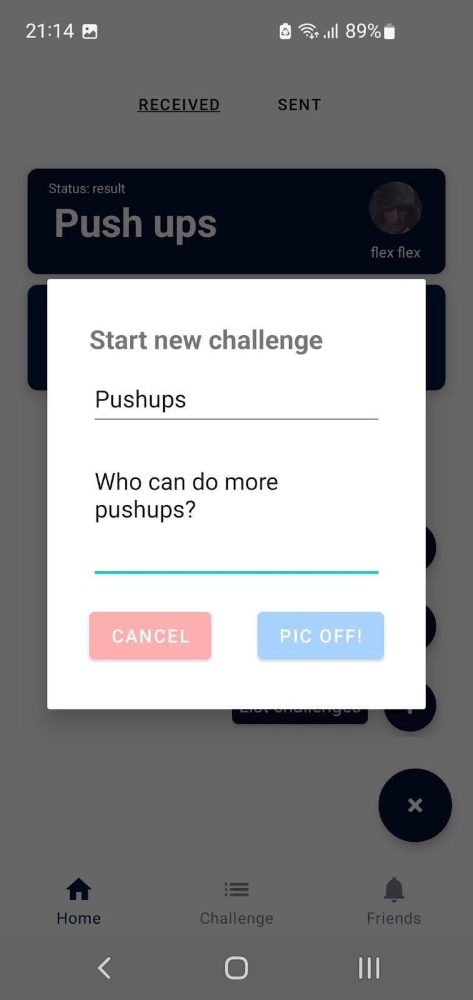

# Pic Off

An Android app for photo challenges between friends. You pick a theme, both of you take a picture, and you each vote on whose is better.

I built it to practice a clean single-activity architecture in Kotlin, with a real backend and a multi-step flow between two users.

| Home | Challenges | Start a challenge |
|:---:|:---:|:---:|
|  |  |  |

## How a challenge works

1. You pick a friend and a challenge (from the list, or a random one), take your photo and send it.
2. Your friend accepts, takes their own photo and sends it back.
3. The recipient votes between the two photos, then the challenger does.
4. Both votes are in, the winner is shown, and the challenge is done.

In the code this is a status string on the challenge in Firebase: `sent`, `open`, `voteRecipient`, `voteChallenger`, `result`, `done`. The home screen sorts challenges into Received and Sent depending on whose turn it is.

Other things it does: Google sign-in, a friends list, and a daily reminder notification at 13:00 that survives a reboot.

## Tech

- Kotlin, single activity with the Navigation Component, ViewBinding
- One `MainViewModel` with LiveData, Firebase listeners feed it
- Firebase Auth (Google), Realtime Database and Storage for challenges and photos
- `AlarmManager` and a boot receiver for the reminder, Glide for images
- minSdk 26

## Build

1. Clone the repo.
2. Create your own Firebase project and put its `google-services.json` into `app/`.
3. Open in Android Studio and run.

## License

MIT, see [LICENSE](LICENSE).
